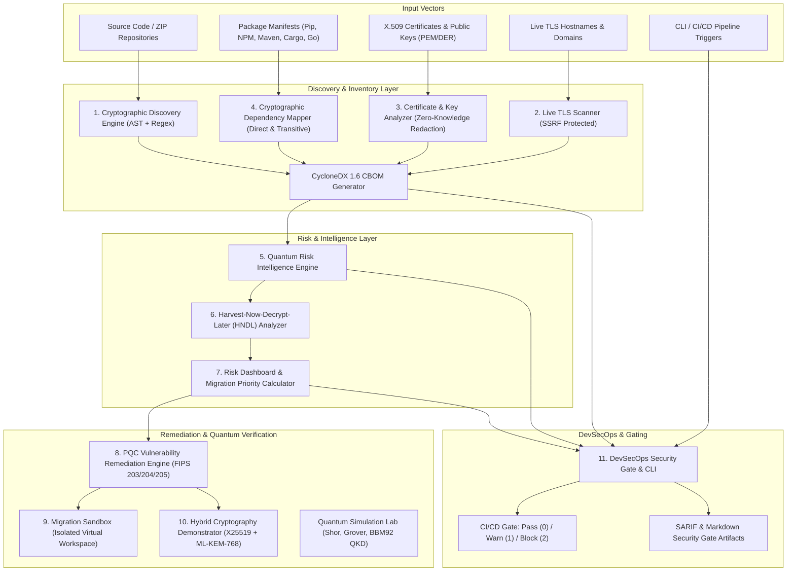

# QUANTUMSHIELD 2.0 🛡️⚛️
### Enterprise Cryptographic Vulnerability Assessment & Post-Quantum Migration Platform

[](https://www.python.org/)
[](https://fastapi.tiangolo.com/)
[](https://react.dev/)
[](https://www.typescript.org/)
[](https://tailwindcss.com/)
[](https://csrc.nist.gov/projects/post-quantum-cryptography)
[]()
[](LICENSE)

> *"How secure is my cryptography today, and how prepared is it for the quantum era?"*

QuantumShield 2.0 is an enterprise-grade cryptographic security platform engineered to audit application source code, package manifests, X.509 certificates, and live TLS servers. It assesses classical cryptographic vulnerabilities alongside post-quantum risks, generates standardized CycloneDX 1.6 Cryptographic Bills of Materials (CBOM), projects Harvest-Now-Decrypt-Later (HNDL) exposure windows, tests NIST FIPS 203/204/205 post-quantum remediation patches in an isolated sandbox, demonstrates hybrid post-quantum key encapsulation, and enforces cryptographic compliance gates directly in DevSecOps CI/CD pipelines.

---

## 📑 Table of Contents

- [Problem Statement & Threat Model](#-problem-statement--threat-model)
- [System Architecture](#-system-architecture)
- [Complete Module Breakdown (11 Modules)](#-complete-module-breakdown-11-modules)
- [Installation & Environment Setup](#-installation--environment-setup)
- [Quick Start Guide](#-quick-start-guide)
- [DevSecOps CLI & CI/CD Security Gate](#-devsecops-cli--cicd-security-gate)
- [REST API Reference](#-rest-api-reference)
- [Viva & Demonstration Guide (10–15 Minutes)](#-viva--demonstration-guide-1015-minutes)
- [Security Hardening & Known Limitations](#-security-hardening--known-limitations)
- [Automated Test Suite](#-automated-test-suite)
- [License](#-license)

---

## 🎯 Problem Statement & Threat Model

### The Quantum Threat
Modern digital infrastructure relies on public-key cryptography (RSA, ECC, ECDSA, ECDH) to secure communications, identities, and financial transactions. 
- **Shor's Algorithm (1994)**: On a cryptographically relevant quantum computer (CRQC), Shor's algorithm solves prime factorization and discrete logarithms in polynomial time $\mathcal{O}((\log N)^3)$, rendering all standard asymmetric cryptosystems broken.
- **Grover's Algorithm (1996)**: Provides quadratic speedup $\mathcal{O}(\sqrt{N})$ against symmetric search spaces, effectively halving key strengths (AES-128 offers only 64-bit quantum security; AES-256 maintains a resilient 128-bit quantum security margin).
- **Harvest-Now-Decrypt-Later (HNDL)**: Adversaries currently intercept and store encrypted high-value communications (financial ledgers, health records, defense data, classified intelligence) to decrypt them retroactively once a CRQC becomes operational. Under Mosca's Theorem ($L + M > Q$), systems where data lifespan ($L$) plus migration duration ($M$) exceeds the time to a CRQC ($Q$) are vulnerable **today**.

### QuantumShield's Mission
QuantumShield 2.0 addresses this risk by providing discovery, quantum risk intelligence, standardized inventory (CBOM), safe isolated migration testing, live hybrid key exchange demonstration, educational quantum simulations, and automated DevSecOps enforcement.

---

## 🏛️ System Architecture



---

## 📦 Complete Module Breakdown (11 Modules)

### Module 1: Cryptographic Discovery Engine
- **Role**: Discovers cryptographic primitives across multiple languages using AST parsing (Python) and context-aware regex patterns (Java, TypeScript/JavaScript, Go, C/OpenSSL, Rust).
- **Capabilities**: Identifies symmetric ciphers, asymmetric algorithms, hash functions, key exchange schemes, and signature verifications. Differentiates weak modes (e.g., AES-ECB vs AES-GCM).
- **Standards**: Automatically generates standardized **CycloneDX 1.6 Cryptographic Bill of Materials (CBOM)** formatted with cryptographic asset OIDs and NIST algorithm classifications.

### Module 2: Live TLS Website Scanner
- **Role**: Connects to user-specified hostnames over port 443 to audit real-world TLS configurations.
- **Capabilities**: Extracts protocol versions (TLS 1.0–1.3), active cipher suites, key exchange mechanisms (ECDHE, DHE, RSA), and server certificate chains.
- **Security**: Hardened against Server-Side Request Forgery (SSRF) with multi-stage loopback, link-local, private IP (`10.0.0.0/8`, `172.16.0.0/12`, `192.168.0.0/16`), cloud metadata (`169.254.169.254`), IPv6 unique local, and DNS-rebinding protection.

### Module 3: Certificate and Key Analyzer
- **Role**: Parses X.509 certificates and public keys in PEM, DER, and PKCS#7 bundle formats.
- **Capabilities**: Extracts Subject, Issuer, Validity Dates, Subject Alternative Names (SAN), public key algorithm, curve names, and modulus bit lengths. Identifies SHA-1 / MD5 signature algorithms and imminent expirations.
- **Privacy Assurance**: Implements strict zero-knowledge redaction for private keys. Private key structures (`BEGIN RSA PRIVATE KEY`, etc.) are detected, neutralized, and replaced with redaction notices before reaching logging, database, or UI layers.

### Module 4: Cryptographic Dependency Mapper
- **Role**: Discovers cryptographic libraries and ecosystem packages from manifest files.
- **Supported Manifests**: `requirements.txt`, `pyproject.toml`, `package.json`, `package-lock.json`, `yarn.lock`, `pom.xml`, `build.gradle`, `go.mod`, `Cargo.toml`, `CMakeLists.txt`, `vcpkg.json`.
- **Capabilities**: Classifies direct vs. transitive dependencies, calculates active usage linkage against source code findings, builds a dependency DAG, and assesses post-quantum readiness status for each library.

### Module 5: Quantum Risk Intelligence Engine
- **Role**: Computes deterministic risk scores and maps quantum algorithm threats.
- **Accurate Cryptographic Physics**:
  - **Shor's Algorithm**: Strictly applied to asymmetric algorithms (RSA, ECC, ECDSA, ECDH, DH, DSA, Ed25519).
  - **Grover's Algorithm**: Applied to symmetric ciphers and hash functions, explaining quadratic speedup $\mathcal{O}(\sqrt{N})$ (AES-128 $\to$ degraded; AES-256 $\to$ safe with 128-bit quantum security).
  - **NIST Post-Quantum Standards**: Categorizes algorithms into Standardized (FIPS 203 ML-KEM, FIPS 204 ML-DSA, FIPS 205 SLH-DSA), Round 4 Candidates (BIKE, HQC), and Classical Vulnerable.

### Module 6: Harvest-Now-Decrypt-Later (HNDL) Risk Analyzer
- **Role**: Evaluates systemic exposure to retroactive decryption of recorded ciphertext.
- **Capabilities**: Implements Mosca's Theorem ($L + M > Q$) by evaluating data shelf life ($L$), migration duration ($M$), and estimated quantum horizon ($Q$).
- **Features**: Pre-configured regulatory data categories (Financial & Payment Records, Personally Identifiable Information, Health Records, Government & Defense Intelligence), manual lifetime override controls, and risk categorization (CRITICAL, HIGH, MEDIUM, LOW).

### Module 7: Risk Dashboard & Migration Priority Calculator
- **Role**: Aggregates multi-vector findings into actionable executive metrics and prioritized remediation queues.
- **Capabilities**: Displays 0–100 Classical Security Score, Quantum Resistance Score, and PQC Readiness Score. Orders findings into a deterministic migration queue based on severity, usage context, exposure risk, and ease of remediation.

### Module 8: PQC Vulnerability Remediation Engine
- **Role**: Generates standards-compliant, context-aware code transformation proposals and unified diffs.
- **Mapping Rules**:
  - RSA Key Transport / ECDH $\to$ **FIPS 203 ML-KEM** (Kyber)
  - RSA Signatures / ECDSA / Ed25519 $\to$ **FIPS 204 ML-DSA** (Dilithium) or **FIPS 205 SLH-DSA** (SPHINCS+)
  - Weak Symmetric (DES, 3DES, Blowfish, AES-128-ECB) $\to$ **AES-256-GCM**
  - Weak Hash (MD5, SHA-1) $\to$ **SHA-256 / SHA-384**
- **Safety**: Each proposal includes rationale, target standard, dependency changes, unified diff, and auto-apply capability flags.

### Module 9: Migration Sandbox
- **Role**: Non-destructive, isolated virtual workspace for previewing and verifying migration patches.
- **Isolation Guarantee**: Sandbox sessions are created in isolated virtual storage. **Original uploaded source files are NEVER modified or overwritten.**
- **Features**: One-click patch application, patch rejection, instant rescan of sandboxed files, and side-by-side Before-and-After deltas showcasing resolved findings and improved scores. Protected against path traversal (`../`, absolute paths).

### Module 10: Hybrid Cryptography Demonstrator
- **Role**: Executable demonstration of hybrid post-quantum key encapsulation recommended by NIST and BSI during migration transition periods.
- **Cryptographic Pipeline**:
  1. Classical **X25519** ECDH shared secret generation (32 bytes).
  2. Quantum-resistant **ML-KEM-768** (FIPS 203) key encapsulation (32-byte shared secret, 1088-byte ciphertext).
  3. **HKDF-SHA256** dual-secret derivation with domain separation.
  4. Authenticated symmetric payload encryption with **AES-256-GCM**.
  5. Built-in **tamper detection test**: Flips ciphertext bits to prove cryptographic integrity verification via AES-GCM authentication tags (`InvalidTag` exception handling).

### Module 11: DevSecOps Security Gate & CLI
- **Role**: CLI tool and CI/CD security gate that enforces cryptographic policies in automated build pipelines.
- **Features**:
  - Deterministic exit codes: `0` (PASS), `1` (BLOCKING FAILURE), `2` (CLI ERROR).
  - Configurable YAML policy files (`.quantumshield.yml`) with thresholds, rule severity, enforcement modes (`BLOCKING`, `ADVISORY`, `MANUAL_REVIEW`), and time-bounded exception handling.
  - Multi-format artifact generation: CycloneDX 1.6 CBOM (`cbom.json`), SARIF 2.1.0 (`quantumshield.sarif`), and GitHub/GitLab job summary Markdown (`quantumshield-report.md`).

---

## 🧪 Quantum Simulation Laboratory (Educational)

Beyond static assessment, QuantumShield includes a dedicated educational quantum laboratory executing statevector and shot-based simulations:
1. **Shor's Algorithm Simulator**: Factorizes composite numbers ($N=15 \to 3 \times 5, a=7$) through quantum order-finding, phase estimation, and continued fraction expansion. Demonstrates modular sequence periods and calculates physical hardware qubit scaling required for RSA-2048 (~4096 logical qubits).
2. **Grover's Algorithm Simulator**: Simulates amplitude amplification over 2 to 4 qubits, demonstrating marked state probability amplification (>94%) in $\mathcal{O}(\sqrt{N})$ iterations. Includes Grover-over-rotation warnings and the AES-128 vs AES-256 quadratic key halving explanation.
3. **BBM92 Entanglement-based QKD Simulator**: Implements the Bennett-Brassard-Mermin (1992) protocol using $|\Phi^+\rangle$ Bell state entangled pairs. Features Alice and Bob random basis selection ($Z$ and $X$), basis sifting, test sample parameter estimation, quantum bit error rate (QBER) calculation, deterministic random seeds, and Eve intercept-resend attack perturbation (QBER $\approx 25\%$ triggering transmission abort at the 11% threshold).

---

## 🛠️ Installation & Environment Setup

### System Prerequisites
- **Python**: Version 3.10 or 3.11 (tested on Python 3.11.6)
- **Node.js**: Version 18.0 or higher
- **Package Managers**: `pip` (Python) and `npm` (Node.js)
- **Operating Systems**: Windows 10/11, Ubuntu 20.04+, macOS 12+

### 1. Clone Repository & Python Environment Setup
```bash
git clone https://github.com/your-org/quantumshield.git
cd quantumshield

# Create virtual environment
python -m venv venv

# Activate virtual environment
# Windows (PowerShell):
.\venv\Scripts\Activate.ps1
# Windows (cmd):
.\venv\Scripts\activate.bat
# Linux / macOS:
source venv/bin/activate

# Install Python backend dependencies
pip install -r backend/requirements.txt
```

### 2. Frontend Setup
```bash
cd frontend
npm install
cd ..
```

---

## 🚀 Quick Start Guide

### Start the Backend Server
From the root directory:
```bash
python -m uvicorn backend.app.main:app --host 127.0.0.1 --port 8000 --reload
```
The FastAPI interactive documentation is available at:
- Swagger UI: `http://127.0.0.1:8000/docs`
- ReDoc: `http://127.0.0.1:8000/redoc`

### Start the Frontend Application
In a separate terminal:
```bash
cd frontend
npm run dev
```
The QuantumShield dashboard will open at `http://localhost:5173`.

---

## ⚙️ DevSecOps CLI & CI/CD Security Gate

QuantumShield provides a dedicated CLI tool for developers and CI/CD pipelines.

### CLI Commands

#### 1. Audit a Local Repository
```bash
python backend/quantumshield_cli.py scan ./my-project --out scan-results.json
```

#### 2. Evaluate CI/CD Security Gate with Policies
```bash
python backend/quantumshield_cli.py devsecops evaluate ./my-project \
  --policy .quantumshield.yml \
  --gate \
  --cbom-out cbom.json \
  --sarif-out quantumshield.sarif \
  --report-out quantumshield-gate.md
```

#### 3. Export Standalone CycloneDX 1.6 CBOM
```bash
python backend/quantumshield_cli.py cbom export ./my-project --out cbom.json
```

#### 4. Manage Policies
```bash
# List built-in security policies
python backend/quantumshield_cli.py policy list

# Generate default configuration template
python backend/quantumshield_cli.py policy init > .quantumshield.yml
```

### `.quantumshield.yml` Policy Configuration Example
```yaml
version: "1.0"
policy_id: "enterprise-pqc-gate"
policy_name: "Enterprise Cryptographic Security Gate"

thresholds:
  max_critical_findings: 0
  max_high_findings: 2
  min_classical_security_score: 80.0
  max_quantum_risk_score: 50.0
  min_quantum_readiness_score: 25.0
  require_cbom: true

rules:
  - id: "rule_reject_md5"
    name: "Block MD5 in Source Code"
    category: "CLASSICAL"
    severity: "CRITICAL"
    enforcement: "BLOCKING_FAILURE"
    algorithm: "MD5"
    remediation: "Migrate immediately to SHA-256 or SHA-384."

  - id: "rule_deprecate_rsa_enc"
    name: "Flag Quantum-Vulnerable RSA Key Transport"
    category: "QUANTUM"
    severity: "HIGH"
    enforcement: "BLOCKING_FAILURE"
    algorithm: "RSA"
    usage: "KEY_EXCHANGE"
    remediation: "Plan migration to NIST FIPS 203 ML-KEM-768."

exceptions:
  - rule_id: "rule_reject_md5"
    file_path: "tests/legacy_test.py"
    reason: "Unit test for legacy database password compatibility verification"
    approved_by: "Security Lead"
    expires_at: "2027-12-31"
```

### GitHub Actions Integration Workflow
Create `.github/workflows/crypto-gate.yml`:
```yaml
name: QuantumShield Cryptographic Security Gate

on:
  push:
    branches: [ main, master ]
  pull_request:
    branches: [ main, master ]

jobs:
  crypto-audit:
    runs-on: ubuntu-latest
    steps:
      - name: Checkout Source Code
        uses: actions/checkout@v4

      - name: Set up Python
        uses: actions/setup-python@v5
        with:
          python-version: '3.11'

      - name: Install QuantumShield Dependencies
        run: |
          pip install -r backend/requirements.txt

      - name: Run Cryptographic Security Gate
        run: |
          python backend/quantumshield_cli.py devsecops evaluate . \
            --policy .quantumshield.yml \
            --gate \
            --cbom-out cbom.json \
            --sarif-out quantumshield.sarif \
            --report-out $GITHUB_STEP_SUMMARY

      - name: Upload SARIF to GitHub Code Scanning
        if: always()
        uses: github/codeql-action/upload-sarif@v3
        with:
          sarif_file: quantumshield.sarif
          category: quantumshield-crypto-audit
```

---

## 📡 REST API Reference

| Endpoint | Method | Description |
| :--- | :--- | :--- |
| `/api/scan/upload` | `POST` | Upload ZIP or multiple source files for full cryptographic audit. |
| `/api/scan/domain` | `POST` | Audit live public TLS domain and certificate chain. |
| `/api/scan/demo` | `POST` | Execute instant scan on pre-loaded demonstration project. |
| `/api/scan/{scan_id}` | `GET` | Fetch comprehensive scan record, CBOM, findings, and scores. |
| `/api/scan/{scan_id}/cbom` | `GET` | Export CycloneDX 1.6 CBOM JSON. |
| `/api/scan/{scan_id}/dependencies` | `GET` | Fetch dependency graph and package PQC readiness. |
| `/api/scan/{scan_id}/hndl` | `GET` | Fetch Mosca HNDL exposure assessment. |
| `/api/scan/{scan_id}/remediation` | `GET` | Fetch automated NIST PQC remediation proposals and unified diffs. |
| `/api/scan/{scan_id}/remediation/apply` | `POST` | Apply patch proposal into isolated virtual sandbox session. |
| `/api/scan/{scan_id}/remediation/reject` | `POST` | Reject patch proposal in sandbox session. |
| `/api/scan/{scan_id}/remediation/rescan` | `POST` | Rescan virtual sandbox and compute Before-and-After deltas. |
| `/api/scan/{scan_id}/remediation/comparison` | `GET` | Fetch sandbox rescan delta metrics. |
| `/api/hybrid/run` | `POST` | Run live X25519 + ML-KEM-768 hybrid key exchange demo. |
| `/api/hybrid/comparison` | `GET` | Retrieve comparative benchmark data (Classical vs Hybrid vs PQC). |
| `/api/quantum/shor` | `POST` | Execute educational Shor's factorization simulation ($N=15$). |
| `/api/quantum/grover` | `POST` | Execute Grover search simulation and amplitude amplification. |
| `/api/quantum/bbm92/run` | `POST` | Execute BBM92 entanglement-based QKD simulation (Ideal vs Eve). |
| `/api/devsecops/evaluate` | `POST` | Evaluate DevSecOps policy gate on uploaded repository. |
| `/api/devsecops/policies` | `GET` | List available DevSecOps security policies. |
| `/api/scan/{scan_id}/report.pdf` | `GET` | Generate and download executive PDF audit report. |

---

## 🎤 Viva & Demonstration Guide (10–15 Minutes)

Use this script during project presentation or evaluation:

```
┌──────────────────────────────────────────────────────────────────────────────┐
│                  QUANTUMSHIELD 2.0 VIVA DEMO SCRIPT                          │
└──────────────────────────────────────────────────────────────────────────────┘
```

### Step 1: Problem Introduction (1 min)
- **Action**: Open the landing page at `http://localhost:5173`.
- **Talking Point**: *"Modern cryptography faces an existential challenge from quantum computing. Shor's algorithm breaks RSA and ECC, while Harvest-Now-Decrypt-Later threats target confidential data today. QuantumShield 2.0 is an enterprise discovery, quantum risk intelligence, and post-quantum migration platform."*

### Step 2: Instant Project Assessment & Discovery (2 mins)
- **Action**: Click **"Test Demo Projects"** $\to$ Select **"Vulnerable Legacy Banking API"**.
- **Talking Point**: *"In seconds, QuantumShield audits Python, Java, and configuration files. It identifies classical issues like MD5 and 3DES alongside quantum vulnerabilities such as RSA-2048."*
- **Highlight**: Point out the **CycloneDX 1.6 CBOM**, asset table with file lines, and 0–100 Scores.

### Step 3: Dependency Mapping & Transitive Risks (2 mins)
- **Action**: Click the **"Dependencies"** tab.
- **Talking Point**: *"Security isn't just in direct source code; it's in the supply chain. Here, QuantumShield maps package manifests, identifying libraries with and without Post-Quantum Cryptography support, and links active code imports to vulnerable packages."*

### Step 4: Harvest-Now-Decrypt-Later (HNDL) Risk Analysis (2 mins)
- **Action**: Scroll to the **"HNDL Risk Analyzer"** section.
- **Talking Point**: *"We implement Mosca's Theorem ($L + M > Q$). If financial data has a 10-year shelf life and migration takes 3 years, but a cryptographically relevant quantum computer arrives in 8 years, our data is vulnerable right now. Notice our exposure score and regulatory presets."*

### Step 5: Isolated PQC Remediation & Sandbox (3 mins)
- **Action**: Click **"PQC Remediation Sandbox"** in the top navigation.
- **Talking Point**: *"Unlike static scanners that only complain about issues, QuantumShield proposes automated NIST FIPS 203/204/205 patches."*
- **Live Action**:
  1. Inspect the unified diff for MD5 $\to$ SHA-256 or RSA $\to$ ML-KEM.
  2. Click **"Apply Patch to Sandbox"**. Emphasize: *"This writes to an isolated virtual sandbox; the original source files are untouched."*
  3. Click **"Rescan Sandbox"**. Show the **Before-and-After Comparison** displaying resolved findings and improved scores.

### Step 6: Live Hybrid Cryptography Demonstrator (2 mins)
- **Action**: Switch to the **"Hybrid Lab"** sub-tab.
- **Talking Point**: *"NIST and BSI recommend hybrid key exchanges during the transition. Here we execute real X25519 ECDH combined with NIST FIPS 203 ML-KEM-768 via HKDF-SHA256, encrypting with AES-256-GCM."*
- **Live Action**: Click **"Run Hybrid KEX Demo with Tamper Test"**. Show how altering 1 bit in the ciphertext triggers an authenticated tag verification failure (`InvalidTag`), proving end-to-end cryptographic integrity.

### Step 7: Quantum Simulation Laboratory (2 mins)
- **Action**: Navigate to **"Quantum Lab"** in the top navbar.
- **Talking Point**: *"To substantiate our theoretical models, we built educational quantum simulators."*
- **Live Action**:
  1. **Shor**: Run $N=15, a=7$, demonstrating order-finding ($r=4$) yielding factors 3 and 5.
  2. **Grover**: Show amplitude amplification on 2–3 qubits with quadratic speedup.
  3. **BBM92 QKD**: Run clean channel (QBER = 0%), then toggle **Eve Intercept-Resend Attack** (QBER $\approx 25\% \ge 11\%$, session aborts).

### Step 8: DevSecOps CI/CD Enforcement & Conclusion (1 min)
- **Action**: Open terminal, run:
  ```bash
  python backend/quantumshield_cli.py devsecops evaluate ./demo_code --gate
  ```
- **Talking Point**: *"Finally, QuantumShield runs in CI/CD pipelines as a deterministic quality gate, blocking vulnerable code before deployment and generating SARIF and CycloneDX 1.6 CBOM artifacts. All 128 regression tests pass with 100% reliability."*

---

## 🔒 Security Hardening & Known Limitations

### Security Hardening Measures
- **Zip Bomb & Archive Slip Protection**: Maximum 2,000 archive entries, 100 MB extracted total limit, 10 MB single-file threshold, and automatic rejection of POSIX symbolic links.
- **Upload Size Bounds**: Hard 50 MB total payload limit enforced on all API upload endpoints (HTTP 413).
- **Multi-Stage SSRF Defense**: TLS scanner validates hostnames against public IP filters, blocking loopback (`127.0.0.1`), private RFC 1918 subnets (`10.0.0.0/8`, `172.16.0.0/12`, `192.168.0.0/16`), link-local, cloud metadata (`169.254.169.254`), and DNS-rebinding attacks.
- **Zero-Knowledge Private Key Redaction**: Zero-retention policy for cryptographic private keys in certificates and source files. Neutralized and redacted before storage or display.
- **Sandbox Directory Traversal Prevention**: Strict regex path sanitization prohibiting parent directory traversals (`../`), root escapes, or drive letters.

### Known Limitations
- **Quantum Simulation Scale**: Quantum simulators (Shor, Grover, BBM92) are educational numerical simulators designed for small-scale demonstration ($N \le 500$, qubits $\le 4$). Simulating Shor's algorithm for actual RSA-2048 would require 4,096 logical qubits and supercomputing clusters beyond personal workstations.
- **No Remote Code Execution**: QuantumShield analyzes source code statically via AST and regex. It does **not** execute arbitrary uploaded code.
- **Local Benchmarking**: Timing measurements in the Hybrid Demonstrator reflect local CPU and memory performance and will vary across host environments.

---

## 🧪 Automated Test Suite

QuantumShield 2.0 includes a comprehensive test suite covering all modules, security boundaries, and determinism.

```bash
# Execute entire test suite
python -m pytest backend -v
```

### Test Coverage Summary (128 / 128 Passing)
- `backend/test_batch8_final_integration.py` (9 tests) — Complete cross-module integration and security hardening.
- `backend/test_devsecops_security_gate.py` (31 tests) — Policy engine, gate rules, SARIF/CBOM export, and CLI.
- `backend/test_quantum_lab.py` (21 tests) — Shor, Grover, BBM92 simulations, seed reproducibility, and APIs.
- `backend/test_dependency_mapper.py` (15 tests) — Manifest parsers, direct/transitive classification, DAG integrity.
- `backend/test_pqc_remediation_sandbox.py` (14 tests) — FIPS mappings, diff generation, sandbox isolation, ML-KEM-768 roundtrip.
- `backend/test_crypto_discovery_cbom.py` (13 tests) — AST detection, regex patterns, CycloneDX 1.6 CBOM schema.
- `backend/test_quantum_risk_intelligence.py` (12 tests) — Unified scoring, Shor/Grover attribution, HNDL matrix.
- `backend/test_tls_cert_analyzer.py` (11 tests) — SSRF protection, X.509 PEM/DER parsing, private key redaction.
- `backend/test_bbm92_engine.py` (1 test) — Bell state entanglement simulation.
- `backend/test_quantum_engine.py` (1 test) — Quantum risk classification.

---

## 📄 License

This project is licensed under the MIT License - see the [LICENSE](LICENSE) file for details.
